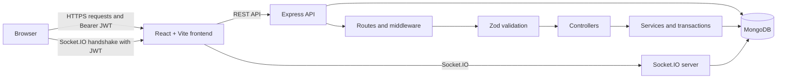

# KaamSetu

KaamSetu is a freelance marketplace where clients publish projects, freelancers submit proposals, and both parties track work through assignment, submission, approval, and project chat. It is a React/Vite frontend backed by an Express, Socket.IO, and MongoDB API.

**Repository:** [shivateja-droid/freelance-app](https://github.com/shivateja-droid/freelance-app)

## Demo

- Frontend: <https://kaamsetu-wheat.vercel.app>
- API: <https://kaamsetu-y4o7.onrender.com>
- API reference: <https://kaamsetu-y4o7.onrender.com/api-docs>

These are the configured deployment targets. Their current availability depends on the respective hosting services.

## What It Does

### Client

- Register and sign in with a JWT-backed account.
- Create projects with a title, description, budget, and required skills.
- Review applications, accept one proposal, or reject applications.
- Review submitted work, request a revision, or approve it to complete the project.
- Use project chat after assignment.

### Freelancer

- Browse available projects and view assigned work.
- Maintain a freelancer profile and skills.
- Submit a proposal with a bid amount and estimated completion time.
- Reapply after a rejected application while preserving the rejected application as history.
- Submit work, revise it after client rejection, and chat with the project client.

### Administrator

- View users, projects, and applications through role-protected views.
- Access project and chat data under the server-side administrator authorization rules.

## Technology

**Frontend**

- React 19, Vite, React Router
- Axios
- Socket.IO Client
- Tailwind CSS, Bootstrap, and Sonner notifications
- Vercel Analytics

**Backend**

- Node.js, Express 5, Socket.IO
- MongoDB and Mongoose
- JWT and bcrypt authentication
- Zod request and Socket.IO payload validation
- Pino structured logging, Helmet, and express-rate-limit
- OpenAPI 3.1 with Swagger UI

**Deployment**

- Vercel for the React/Vite frontend
- Render for the Node.js backend
- MongoDB Atlas for the production database

## Architecture



For protected HTTP requests, the frontend sends `Authorization: Bearer <token>`. The backend verifies the token, loads the current user, applies role and ownership checks, validates input, and then calls the relevant service. The same JWT is supplied through the Socket.IO authentication handshake for chat events.

Application approval, project assignment, registration of freelancer profiles, and project completion use MongoDB transactions. A local database used for those workflows must support transactions, which normally means a replica set deployment such as MongoDB Atlas or a locally initialized replica set.

## Project Structure

```text
freelance-app/
|- client/                    # React/Vite application
|  |- src/
|  |  |- components/          # Shared UI and route protection
|  |  |- context/             # Authentication/session and socket context
|  |  |- pages/               # Client, freelancer, and administrator screens
|  |  `- utils/               # Frontend utilities
|  |- package.json
|  `- vercel.json             # SPA rewrite configuration
|- server/                    # Express and Socket.IO application
|  |- config/                 # Database, CORS/runtime, chat, shutdown config
|  |- controllers/            # HTTP response handling
|  |- docs/                   # OpenAPI document, Socket.IO, deployment notes
|  |- middleware/             # Authentication and Zod validation middleware
|  |- migrations/             # Explicit database migration tools
|  |- observability/          # Pino logging, health, transaction helpers
|  |- routes/                 # Express route registration
|  |- services/               # Marketplace business rules and transactions
|  |- test/                   # Node test suite
|  |- validation/             # Zod schemas
|  |- Schema.js               # Mongoose models and indexes
|  `- index.js                # Server startup and middleware wiring
`- README.md
```

## Prerequisites

- Node.js `>=22.12.0 <25` (Node.js 22.x is the recommended deployment target).
- npm.
- A MongoDB deployment that supports transactions for the marketplace lifecycle.

No root `package.json` exists; install and run the client and server independently.

## Local Setup

Clone the repository and open it in VS Code:

```powershell
git clone https://github.com/shivateja-droid/freelance-app.git
cd freelance-app
code .
```

Install backend dependencies and create `server/.env` from the documented variables below:

```powershell
cd server
npm install
npm run dev
```

In a second terminal, install and run the frontend:

```powershell
cd client
npm install
npm run dev
```

Vite serves the frontend at the address shown in its terminal, normally `http://localhost:5173`. The API defaults to port `3001` when `PORT` is not supplied. On Windows systems where PowerShell blocks `npm.ps1`, use `npm.cmd` in place of `npm`.

### Backend Environment

Create `server/.env` locally. Do not commit it.

```dotenv
NODE_ENV=development
PORT=3001
MONGO_URI=<transaction-capable MongoDB connection URI>
JWT_SECRET=<a-long-random-secret>
CLIENT_ORIGINS=https://kaamsetu-wheat.vercel.app
ALLOW_LOCAL_ORIGIN=true
LOG_LEVEL=info
LOG_PRETTY=true
```

`NODE_ENV` must be exactly `development`, `test`, or `production`. `CLIENT_ORIGINS` is a comma-separated allowlist of HTTPS origins with no paths or trailing slashes. In development only, `ALLOW_LOCAL_ORIGIN=true` additionally permits `http://localhost:5173`; it does not enable local origins in production. Production startup requires `JWT_SECRET`, `MONGO_URI`, and at least one `CLIENT_ORIGINS` value, and requires a `JWT_SECRET` of at least 32 characters.

### Frontend Environment

Create `client/.env` locally:

```dotenv
VITE_API_URL=http://localhost:3001
```

Only variables prefixed with `VITE_` are included in the browser build. Never put secrets in them.

## Commands

Run commands from the corresponding directory.

| Area | Command | Purpose |
| --- | --- | --- |
| Server | `npm run dev` | Start the backend with Nodemon. |
| Server | `npm start` | Start the backend with Node.js. |
| Server | `npm test` | Run the backend Node test suite. |
| Server | `npm run docs:check` | Validate the OpenAPI document and registered routes. |
| Client | `npm run dev` | Start the Vite development server. |
| Client | `npm run build` | Create a production frontend build. |
| Client | `npm run lint` | Run the frontend ESLint configuration. |
| Client | `npm run preview` | Preview the frontend production build. |

The server also includes explicit migration and audit scripts. Read the migration documentation and inspect the intended database before running any `:apply` or rollback command; migrations are not part of normal application startup.

## API and Realtime Documentation

The backend serves its API reference at:

- Local Swagger UI: <http://localhost:3001/api-docs>
- Local OpenAPI JSON: <http://localhost:3001/api-docs/openapi.json>
- Production Swagger UI: <https://kaamsetu-y4o7.onrender.com/api-docs>

The OpenAPI reference documents the public HTTP endpoints, request validation, Bearer JWT security, role requirements, and error response shapes. It includes registration, login, current-user, project, application, freelancer, administrator, and chat endpoints.

Socket.IO has its own protocol documentation in [server/docs/socket-io.md](server/docs/socket-io.md). The server authenticates the handshake with the JWT, strictly validates event payloads, authorizes project participation, assigns the chat message sender from the authenticated user, rate-limits messages, and keeps the most recent 100 messages per chat.

## Security and Reliability

- Passwords are hashed with bcrypt; the client never receives password hashes.
- JWTs identify a server-loaded user and expire after 12 hours.
- Public registration permits only `client` and `freelancer` roles. Administrator accounts cannot be created through the public endpoint.
- Zod schemas reject malformed, unexpected, and protected request fields before business logic runs.
- Role, ownership, project visibility, and chat-participant checks are enforced by the backend.
- MongoDB ObjectId relationships and partial unique indexing prevent concurrent active duplicate applications while retaining rejected application history.
- Helmet, payload-size limits, HTTP rate limits, CORS origin allowlisting, and Socket.IO origin checks reduce common attack surfaces.
- Pino logs request metadata and server errors with redaction for authorization data, passwords, tokens, and connection strings. Health endpoints are available at `/health/live` and `/health/ready`.

## Deployment Configuration

The React SPA is configured for Vercel with a rewrite to `index.html`. Set this Vercel build variable:

```dotenv
VITE_API_URL=https://kaamsetu-y4o7.onrender.com
```

For the Render backend, configure `NODE_ENV=production`, `JWT_SECRET`, `MONGO_URI`, and `CLIENT_ORIGINS`. The intended production frontend origin is:

```text
https://kaamsetu-wheat.vercel.app
```

Use Node.js 22 on Render to align with the declared engine range. Preview origins are blocked unless explicitly added to `CLIENT_ORIGINS`. See [server/docs/deployment.md](server/docs/deployment.md) for the full non-secret deployment-variable guidance.

## Screenshots

No project screenshots are currently committed to this repository. Add verified screenshots here when they are available.

## Troubleshooting

| Symptom | Check |
| --- | --- |
| Frontend cannot reach the API | Verify `VITE_API_URL`, restart Vite after changing it, and confirm the backend is running. |
| Browser receives `403 Origin not allowed` | Check that the exact browser origin is in `CLIENT_ORIGINS`; do not include a path or trailing slash. |
| Backend fails during startup | Confirm `NODE_ENV`, `MONGO_URI`, and `JWT_SECRET` are present. Production also needs a non-empty `CLIENT_ORIGINS`. |
| Transaction-backed workflow fails locally | Use a MongoDB replica set or a transaction-capable hosted cluster. Standalone MongoDB does not support the required transactions. |
| Socket connection is rejected | Sign in again and ensure the Socket.IO client is using a current JWT and an allowed frontend origin. |
| API documentation does not open | Start the backend, then visit `/api-docs`; run `npm run docs:check` in `server` to validate the document. |

## Current Limitations and Future Work

- The automated suite is backend-focused; dedicated frontend component and browser end-to-end coverage would improve UI regression protection.
- Chat rate limiting is in-memory and process-local, so a multi-instance deployment would need a shared store for globally consistent limits.
- Operational monitoring, alerting, and centralized log aggregation are not configured in this repository.
- Database migrations require an explicit review and run against the intended database; they are deliberately not automatic.

## Contributing

Keep changes focused, preserve server-side validation and authorization, and run the relevant checks before opening a pull request. For backend changes, run `npm test` and `npm run docs:check` from `server`; for frontend changes, run `npm run build` and `npm run lint` from `client`.

## License

No repository-wide `LICENSE` file is currently included. The backend package metadata declares `ISC`; add an explicit root license file before relying on that as the project-wide license.
